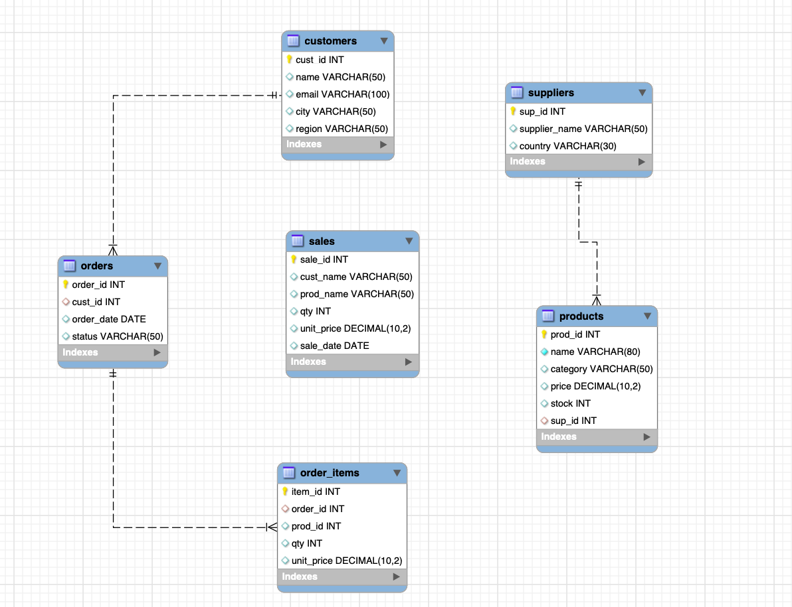

# Data_Management_Engineering 2026-27
This repository is designed for student lab materials for courses Data Management Engineering (MGT5492) of business analytics program at Adam Smith Business School, University of Glasgow, 2025-26.

## Subjects
- Lab1: Introduction, Creating & Populating Tables
- Lab2: Products Table, CRUD, Filtering & Schema Changes
- Lab3: Relationships & Joins
- Lab4: Aggregation & Computation
- Lab5: Basic Data Security

## Learning Goal
- Lab1:
  - Install and connect to MySQL.
  - Understand databases, tables, rows, and columns.
  - Define and use a PRIMARY KEY.
  - Create tables and insert data.
  - Run basic SELECT queries to retrieve data.

- Lab2:
  - Create and modify a database table
  - Perform CRUD operations: Create, Read, Update, Delete
  - Apply filtering, sorting, and pagination
  - Use conditional expressions (=, <, >, AND, OR, BETWEEN, IN, LIKE)
  - Handle NULL values
  - Perform schema changes using ALTER TABLE and RENAME TABLE

- Lab3:
  - Define relationships between tables using FOREIGN KEY
  - Understand one-to-many and many-to-many relationships
  - Perform INNER JOIN, LEFT JOIN, and RIGHT JOIN queries
  - Combine multiple tables to extract business insights

- Lab4:
  - Use SQL aggregate functions (SUM, COUNT, AVG, MIN, MAX).
  - Apply GROUP BY and HAVING for grouped analysis.
  - Use subqueries for deeper business insights.
  - Write simple analytical queries to support business decision-making.

- Lab5:
  - Essential security siutations
    - Create user,
    - Grant read-only,
    - Mask emails via a view,
    - Safe drops.
  - Business Questions


## Database Design
The database is designed ideally for teaching purpose with random data inserted in each table. 
The relationship is followed by the ERD below:


## Re-creating tables
In case of the student's mistake and misunderstanding for table's relationship and inserted multiple times of data. 
The code of `NEWDB_Creation.sql` is used for quickly re-creating all tables in a new database: `retail_1` as a copy to capture the current lab progress. 

```sql
CREATE DATABASE retail_1;
USE retail;

CREATE TABLE customers (...);
CREATE TABLE products (...);
CREATE TABLE suppliers (...):
CREATE TABLE orders (...);
CREATE TABLE order_items (...);
CREATE TABLE sales (...);

INSERT INTO ... () VALUE (...);

ADD CONSTRAINT fk_order_order_items FOREIGN KEY ()...;
ADD CONSTRAINT fk_order_customers FOREIGN KEY ()...;
ADD CONSTRAINT fk_suppliers_products FOREIGN KEY ()...;
```
The preudo code is used as a quick start point to re-create a new DB. The whole code refers `NEWDB_Creation.sql`
